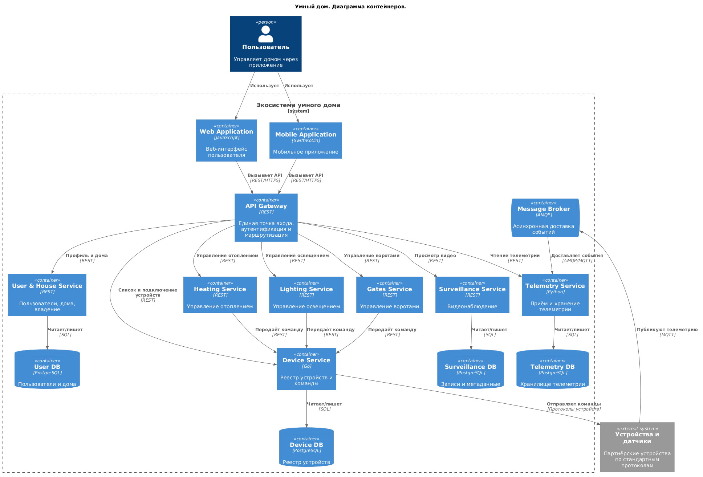
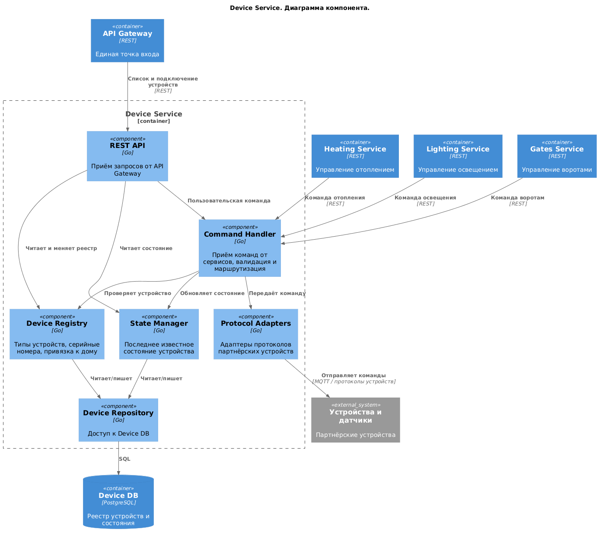
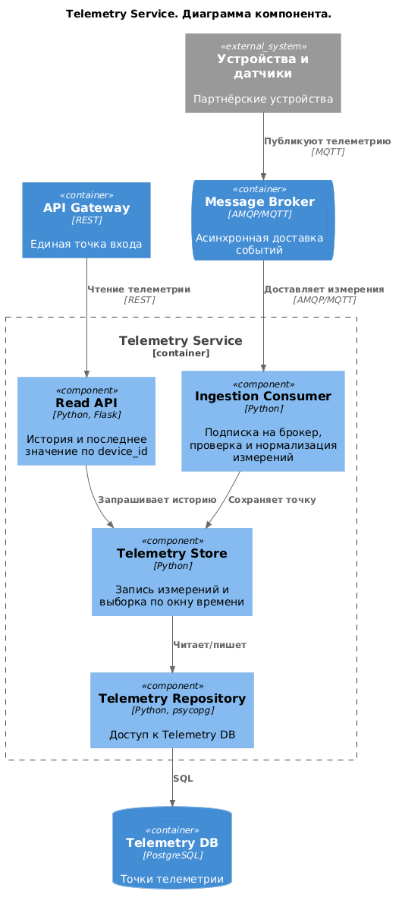
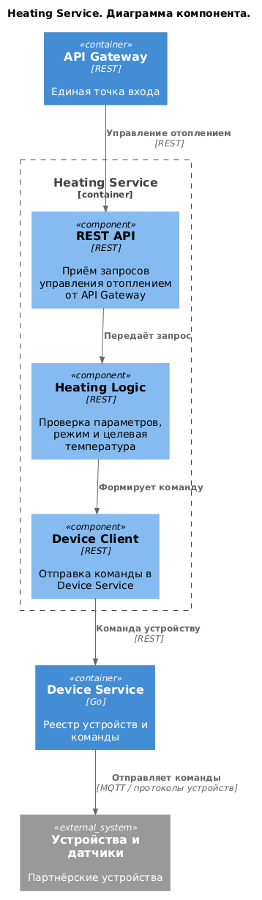
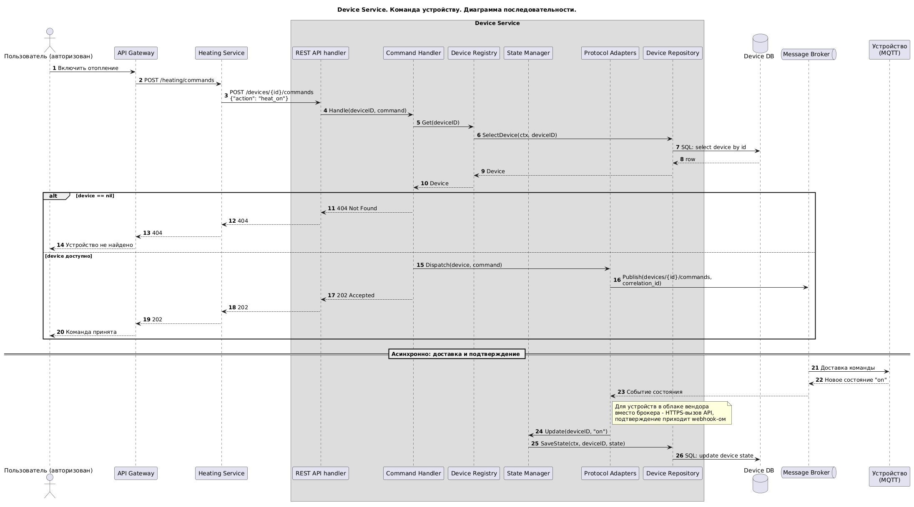
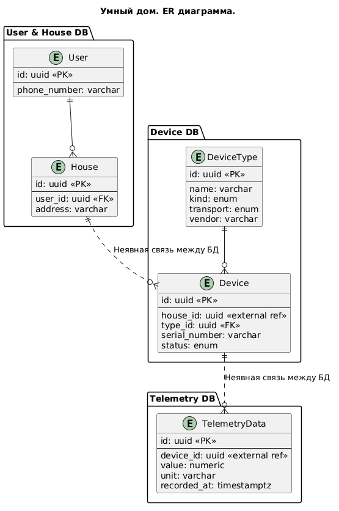

# Project_template

Это шаблон для решения проектной работы. Структура этого файла повторяет структуру заданий. Заполняйте его по мере работы над решением.

# Задание 1. Анализ и планирование

<aside>

Чтобы составить документ с описанием текущей архитектуры приложения, можно часть информации взять из описания компании и условия задания. Это нормально.

</aside

### 1. Описание функциональности монолитного приложения

**Управление отоплением:**

- Пользователи могут создавать, читать, обновлять и удалять датчики (CRUD)
- Система поддерживает учёт записей о датчиках
- Управления прибором нет. Команда включить/выключить отопление никуда не отправляется

**Мониторинг температуры:**

- Пользователи могут запрашивать температуру датчиков
- Система поддерживает запрос значения у датчиков (заглушка temperature-api)
- История значений не хранится
- Поддерживаются только датчики температуры

### 2. Анализ архитектуры монолитного приложения

- Монолит
- Масштабируемость ограничена, так как монолит сложно масштабировать по частям
- Развёртывание требует остановки всего приложения
- Язык Go 
- СУБД PostgreSQL (всего одна таблица sensors)
- Обработка запросов, бизнес-логика и работа с данными в одном приложении
- Взаимодействие синхронное. Приложение опрашивает temperature-api по запросу (pull)
- Внешний контур — REST API без авторизации

### 3. Определение доменов и границы контекстов

#### Домены

- Управление устройствами (реестр устройств, их типы, регистрация, команды управления)
- Управление приборами (отопление, освещение, ворота и т.д.)
- Наблюдение (удалённое видеонаблюдение)
- Телеметрия (сбор, хранение и предоставление показаний)
- Пользователи и дома (аккаунты, дома, устройства)

#### Границы контекстов

- **As-Is** — в монолите есть только "Управление устройствами" (реестр датчиков температуры) и "Телеметрия" (текущее значение без истории). "Пользователи и дома", "Управление приборами" и "Наблюдение" отсутствуют.
- **To-Be** — по бизнес-целям необходимо добавить "Управление приборами", "Наблюдение" и "Пользователи и дома", а существующие домены расширяются (история телеметрии, любые датчики партнёров, команды устройствам).

### 4. Проблемы монолитного решения (текущего решения)

- Нет авторизации (кто угодно может создавать и менять датчики)
- Датчики не привязаны ни к пользователям, ни к домам
- "Управление" приборами отсутсвует
- Поддерживается только один тип датчика — датчики температуры
- Отсутствует полноценное логирование, нет мониторинга
- Синхронный API temperature-api (его сбой ломает получение температуры)
- temperature-api не реализован вообще
- docker-compose.yml нерабочий
- сервис postgres в docker-compose.yml без настроек и healthcheck
- temperature-api в docker-compose.yml пустой — развернуть нельзя ни локально, ни в проде
- Отсутствуют клиентские интерфейсы
- Каждый новый тип датчика требует правки кода
- temperature-api по факту — мок датчика, а не API и не телеметрия

### 5. Визуализация контекста системы — диаграмма С4

```markdown
[Умный дом. Диаграмма контекста.](./docs/context.png)
```

# Задание 2. Проектирование микросервисной архитектуры

В этом задании вам нужно предоставить только диаграммы в модели C4. Мы не просим вас отдельно описывать получившиеся микросервисы и то, как вы определили взаимодействия между компонентами To-Be системы. Если вы правильно подготовите диаграммы C4, они и так это покажут.

**Диаграмма контейнеров (Containers)**


Исходник: [`docs/containers.puml`](./docs/containers.puml).

**Диаграмма компонентов (Components)**

Device Service:


Исходник: [`docs/components-device.puml`](./docs/components-device.puml)

Telemetry Service:


Исходник: [`docs/components-telemetry.puml`](./docs/components-telemetry.puml)

Heating Service:


Исходник: [`docs/components-heating.puml`](./docs/components-heating.puml)

**Диаграмма кода (Code)**

!!! Согласно описанию задачи в Яндекс Практикум, разрешено вместо диаграммы кода использовать диаграмму последовательности.
На мой взгляд диаграмма последовательности имеет большую ценность, чем диаграмма кода.


Исходник: [`docs/code-command-sequence.puml`](./docs/code-command-sequence.puml)

# Задание 3. Разработка ER-диаграммы


Исходник: [`docs/er.puml`](./docs/er.puml)

# Задание 4. Создание и документирование API

### 1. Тип API

**REST (OpenAPI 3.0)** — для синхронных операций.

**AsyncAPI (MQTT через брокер)** — для асинхронных потоков: показания устройств, доставка команды, событие состояния с подтверждением. Устройства находятся за NAT и держат исходящее соединение с брокером, поэтому команда не может быть доставлена к ним HTTP-запросом.

### 2. Документация API

- Device Service: [`docs/device-service.openapi.yaml`](./docs/device-service.openapi.yaml)
- Telemetry Service: [`docs/telemetry-service.openapi.yaml`](./docs/telemetry-service.openapi.yaml)
- Асинхронные события: [`docs/asyncapi.yaml`](./docs/asyncapi.yaml)

# Задание 5. Работа с docker и docker-compose

Перейдите в apps.

Там находится приложение-монолит для работы с датчиками температуры. В README.md описано как запустить решение.

Вам нужно:

1) сделать простое приложение temperature-api на любом удобном для вас языке программирования, которое при запросе /temperature?location= будет отдавать рандомное значение температуры.

Locations - название комнаты, sensorId - идентификатор названия комнаты

```
	// If no location is provided, use a default based on sensor ID
	if location == "" {
		switch sensorID {
		case "1":
			location = "Living Room"
		case "2":
			location = "Bedroom"
		case "3":
			location = "Kitchen"
		default:
			location = "Unknown"
		}
	}

	// If no sensor ID is provided, generate one based on location
	if sensorID == "" {
		switch location {
		case "Living Room":
			sensorID = "1"
		case "Bedroom":
			sensorID = "2"
		case "Kitchen":
			sensorID = "3"
		default:
			sensorID = "0"
		}
	}
```

2) Приложение следует упаковать в Docker и добавить в docker-compose. Порт по умолчанию должен быть 8081

3) Кроме того для smart_home приложения требуется база данных - добавьте в docker-compose файл настройки для запуска postgres с указанием скрипта инициализации ./smart_home/init.sql

Для проверки можно использовать Postman коллекцию smarthome-api.postman_collection.json и вызвать:

- Create Sensor
- Get All Sensors

Должно при каждом вызове отображаться разное значение температуры

Ревьюер будет проверять точно так же.

Done

# **Задание 6. Разработка MVP**

Необходимо создать новые микросервисы и обеспечить их интеграции с существующим монолитом для плавного перехода к микросервисной архитектуре. 

### **Что нужно сделать**

1. Создайте новые микросервисы для управления телеметрией и устройствами (с простейшей логикой), которые будут интегрированы с существующим монолитным приложением. Каждый микросервис на своем ООП языке.
2. Обеспечьте взаимодействие между микросервисами и монолитом (при желании с помощью брокера сообщений), чтобы постепенно перенести функциональность из монолита в микросервисы. 

В результате у вас должны быть созданы Dockerfiles и docker-compose для запуска микросервисов. 

Done

### **Реализация**

- **Device Service** - Go, порт 8082, своя БД `devices` (`GET /devices`, `POST /devices`, `GET /devices/{id}`, `PATCH /devices/{id}`).
- **Telemetry Service** - Python/Flask, порт 8083, своя БД `telemetry`. `POST /telemetry` (приём показания), `GET /telemetry?deviceId=` (история).
- **Интеграция с монолитом** - по паттерну strangler fig: монолит проксирует `/api/v1/devices` и `/api/v1/telemetry` в новые сервисы, а при чтении датчиков отправляет показания в Telemetry Service. Внешний контракт монолита при этом не меняется.
- **docker-compose** — монолит, `temperature-api` и два новых сервиса, у каждого своя база: 7 контейнеров.

Взаимодействие в MVP — REST. Брокер сообщений из целевой архитектуры заменён прямыми HTTP-вызовами: так проще запускать и проверять. 
В целевой схеме те же сообщения идут через брокер (`docs/asyncapi.yaml`), поэтому идентификатор устройства в телеметрии — строка: UUID из Device Service или числовой id сенсора монолита в переходный период.

Проверка (стек из `apps/`):

```bash
curl "http://localhost:8080/api/v1/devices"
curl "http://localhost:8080/api/v1/sensors"
curl "http://localhost:8080/api/v1/telemetry?deviceId=1"
```